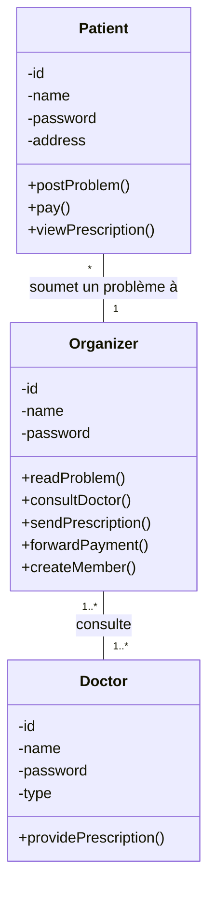

# UML exo 1 - Hospital Management System - Task 1

Class diagram : Patient, Doctor, Organizer.
Dessin à la main : voir `exo1_task1.jpg`.

## Associations
- **Patient - Organizer** : le patient ne parle qu'à l'Organizer (problème, ordonnance, paiement). Un Organizer gère plusieurs patients (`*`), chaque problème est traité par un seul Organizer (`1`).
- **Organizer - Doctor** : l'Organizer consulte les médecins et leur reverse le paiement. `1..*` des deux côtés.
- **Patient - Doctor** : pas de lien direct, tout passe par l'Organizer.
